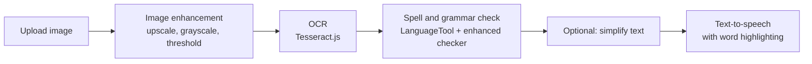
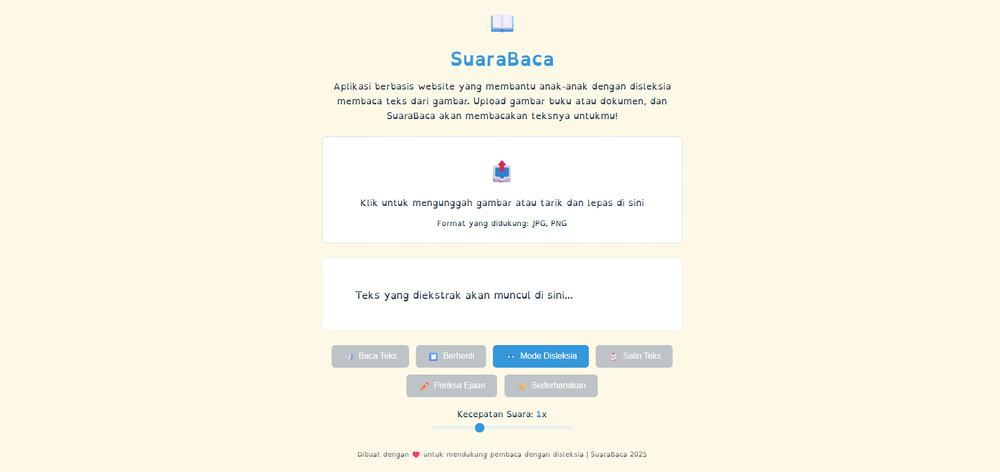

# SuaraBaca

**A text-to-speech reading assistant for people with dyslexia, especially children.**

SuaraBaca turns a photo or scan of printed text into text that can be corrected, simplified, and read aloud, with a dyslexia-friendly interface. A user uploads an image, the app extracts the text with OCR, checks spelling and grammar, and reads the result out loud in Indonesian while highlighting each word as it is spoken.

Built as a group project at Informatics, Institut Teknologi Nasional Bandung (2025).

---

## Why

Dyslexia makes reading, writing, and spelling harder, even for people of normal or above-average intelligence. Much of what people need to read (books, forms, posters, notes) exists only as printed text. SuaraBaca aims to make that text accessible through a combination of reading and listening, in one simple workflow.

---

## Features

- **Image upload:** accepts `.jpg`, `.jpeg`, and `.png`, from a scanned page or a phone camera photo.
- **Automatic image enhancement:** the image is upscaled, converted to grayscale, and thresholded before OCR to improve recognition.
- **OCR in the browser:** text is extracted with Tesseract.js (Indonesian), so the image is processed on the user's device.
- **Spell and grammar checking:** uses the LanguageTool API for context-aware corrections.
- **Enhanced spell checker:** an extra pass for informal writing such as `gk`, `bgt`, `yg`, `tdk`, and for typing mistakes.
- **Highlight and suggestions:** mistakes are highlighted and the user can accept or ignore each suggestion.
- **Text-to-speech:** reads the text aloud in Indonesian.
- **Word-by-word highlighting:** the word currently being spoken is marked, so users can follow along visually and by ear.
- **Speed control:** adjustable reading speed.
- **Dyslexia mode:** switches the text to the OpenDyslexic font, designed to make similar letters (such as `b`/`d` and `p`/`q`) easier to tell apart.
- **Simplify text:** rewrites long, complex sentences into simpler ones.
- **Copy and stop controls** for the recognized text and audio.

---

## How It Works



---

## Screenshot

The whole app lives on a single page: upload an image, then read, check, simplify, and listen to the extracted text.



---

## Tech Stack

| Layer | Technology |
| --- | --- |
| Backend | Python, Flask |
| Frontend | HTML, CSS, JavaScript |
| OCR | Tesseract.js |
| Spell and grammar | LanguageTool API |
| Speech | Browser speech synthesis (Indonesian voice) |
| Accessibility | OpenDyslexic font |

---

## Project Structure

```
SuaraBaca/
├── static/             # CSS, JavaScript, fonts
├── templates/          # HTML templates
├── app.py              # Flask app
└── requirements.txt    # Python dependencies
```

---

## Limitations and Future Work

- OCR accuracy depends on image quality, so blurry or low-contrast photos may need to be retaken.
- Spell and grammar checking relies on the public LanguageTool API, so it needs an internet connection.
- Text simplification is rule-based, so a language-model approach could handle more cases.
- No user testing with people with dyslexia was done in this project; that would be the most important next step.

---

## Team

- Wafiq Mariatul Azizah
- Raden Dika Natakusumah
- Defina Hazimah
- Rhestu Dzulkifli
